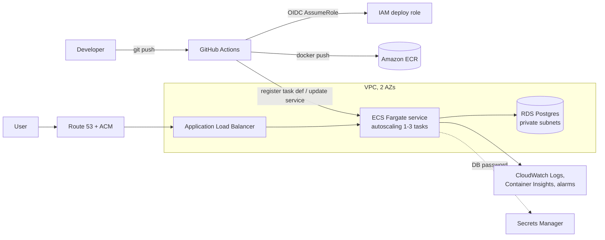

# Containerised Web App on AWS ECS Fargate with Terraform and GitHub Actions CI/CD

A containerised Python API deployed to **Amazon ECS on Fargate** behind an **Application Load Balancer**, with an optional **RDS Postgres** database. All infrastructure is **Terraform**. Every push to `main` is built, scanned and deployed by **GitHub Actions** using **OIDC**, so no long-lived AWS keys are stored in GitHub. Failed deployments roll back automatically through the ECS deployment circuit breaker.

## Architecture



## What it shows

| Area | Implementation |
|---|---|
| Infrastructure as Code | Terraform: VPC with public and private subnets across 2 AZs, security groups that chain ALB → tasks → database, ECR, ECS, ALB, RDS, IAM, autoscaling, alarms |
| CI | Ruff lint, pytest, `terraform fmt` + `validate`, Checkov IaC scanning, Trivy container image scanning |
| CD | Build, push to ECR tagged with the commit SHA, render a new task definition, rolling deploy, wait for stability, smoke test that checks the new version is live |
| Security | GitHub OIDC (no static keys), deploy role limited to one repo's `main` branch and one service, non-root container with a read-only root filesystem, RDS-managed master password in Secrets Manager, database reachable only from the tasks, encrypted storage, TLS 1.3 policy when HTTPS is on |
| Reliability | ALB health checks, deployment circuit breaker with automatic rollback, target tracking autoscaling on CPU, alarms for unhealthy targets and 5xx errors |
| Cost control | No NAT gateway by default (`private_tasks = false`), smallest Fargate and RDS sizes, 7-day log retention, ECR lifecycle policy, one-command teardown |

## Repository layout

```
app/                    FastAPI service, Dockerfile, tests
terraform/              All infrastructure
.github/workflows/      ci.yml (checks) and deploy.yml (CD)
```

## Deploy (proof of concept)

Prerequisites: Terraform 1.6+, AWS CLI with credentials for a sandbox account, and a GitHub repository for this code.

1. **Create the infrastructure**
   ```bash
   cd terraform
   cp terraform.tfvars.example terraform.tfvars   # set github_repo = "owner/repo"
   terraform init
   terraform apply
   ```
   The service starts before any image exists, so its first tasks fail until step 3 pushes one. That is expected.

2. **Configure GitHub.** In the repository's *Settings → Secrets and variables → Actions → Variables*, add:

   | Variable | Value |
   |---|---|
   | `AWS_REGION` | e.g. `us-east-1` |
   | `AWS_DEPLOY_ROLE_ARN` | `terraform output github_deploy_role_arn` |
   | `ECR_REPOSITORY` | the last path segment of `terraform output ecr_repository_url` |
   | `ECS_CLUSTER` | `terraform output ecs_cluster_name` |
   | `ECS_SERVICE` | `terraform output ecs_service_name` |
   | `TASK_FAMILY` | `terraform output task_definition_family` |
   | `APP_URL` | `terraform output app_url` (optional, enables the smoke test) |

3. **Deploy.** Push to `main` (or run the *Deploy to ECS* workflow manually). Open the app URL: `/` shows the running version and the database status, `/visits` increments a counter stored in Postgres.

4. **Try a rollback.** Change `/health` to return a 500, push, and watch the circuit breaker roll the service back to the previous revision.

**If the account already has a GitHub OIDC provider**, set `create_github_oidc_provider = false`.

## Cost

The default POC is about **USD 0.08 per hour (roughly USD 2 a day)**: the ALB, one small Fargate task, a `db.t4g.micro` RDS instance and public IPv4 addresses. Setting `private_tasks = true` adds a NAT gateway (about USD 1 a day more). Run it for a few hours, take screenshots, then destroy it.

## Tear down

```bash
cd terraform
terraform destroy
```

`force_delete` on ECR and `skip_final_snapshot` on RDS let a POC tear down cleanly. Change both before using this for anything real. Then check the console for anything left behind: the ECS service, load balancer, RDS instance, NAT gateway, Elastic IPs and the `/ecs/...` log group.

## Production next steps

Tasks in private subnets with VPC endpoints, Multi-AZ RDS with deletion protection and final snapshots, WAF on the ALB, an S3 state backend with locking, blue/green with CodeDeploy, and separate staging and production environments promoted through GitHub environments with required reviewers.
